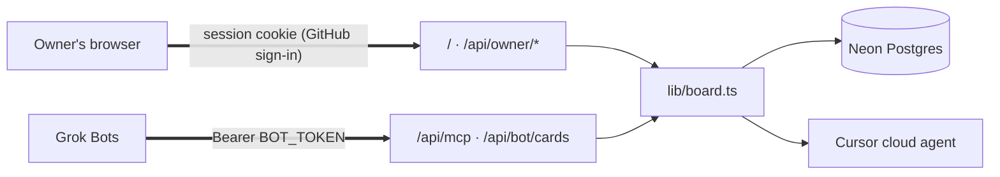

# grokbot-kanban

A kanban for one owner and a roster of [Grok Bot](https://docs.x.ai/grok-bot/get-started) bots. Bots file, claim, annotate, and move cards over MCP or HTTP. Only you delete cards.

The board is meant to be served at `grok-bot-kanban.hiraoku.dev`. This repo does not deploy itself.

## Architecture

The owner signs in with GitHub and the browser keeps a session cookie, every Grok Bot calls `/api/mcp` with the shared `BOT_TOKEN`, and both go through `lib/board.ts` to Neon Postgres. The server calls Cursor's API itself when a card is handed to a Cursor agent.



[docs/architecture.md](docs/architecture.md) has the full diagram, the Run sequence between the coordinating Bot and the others, and a table of every authentication path with what limits it sets for more than one user.

## Set up

1. Use Node.js 22.
2. Install dependencies with `npm install`.
3. Copy `.env.example` to `.env.local`.
4. Fill the variables in the next section. Leave `.env.example` empty.
5. For a local board without Neon, set `DATABASE_URL=pglite`. The data stays in this process and disappears when it stops.
6. For Neon, put the pooled connection string in `DATABASE_URL` and run `npm run db:migrate`. It applies every file in `drizzle/` in order, and each file is safe to run again. Run it again after pulling a change that adds a file.
7. Start the app with `npm run dev` and open http://localhost:3000.

`npm test` uses an in-memory Postgres. It does not need Neon. `npm run test:e2e` builds the app, serves it on port 3210 with an in-memory database, and drives the board in a real browser with Playwright at desktop, laptop, and phone sizes, with stand-ins for GitHub sign-in and Cursor; run `npx playwright install chromium` once first, and stop `npm run dev` before, since both use `.next`.

The interface is built with Tailwind CSS and [shadcn/ui](https://ui.shadcn.com) components, which live in `components/ui` as ordinary source files. Add more with `npx shadcn@latest add <name>`.

## Environment variables

| Variable | Required | Purpose |
| --- | --- | --- |
| `DATABASE_URL` | yes | Neon connection string. `pglite` is local only. |
| `GITHUB_CLIENT_ID` | yes | Client ID of the GitHub OAuth app you sign in with. |
| `GITHUB_CLIENT_SECRET` | yes | That app's client secret. |
| `OWNER_GITHUB_LOGIN` | yes | Your GitHub username. Only this account can sign in. |
| `BOT_TOKEN` | yes | Bearer token for `/api/bot/cards`, at least 32 characters. |
| `STUDIO_URL` | no | `https` target of the Studio link. |
| `CURSOR_API_KEY` | no | Cursor API key, from Cursor Dashboard → Integrations. With it, Run can hand cards to a Cursor cloud agent. |

Generate `BOT_TOKEN` with `openssl rand -base64 32`. It must differ from `GITHUB_CLIENT_SECRET` and `CURSOR_API_KEY`.

`OWNER_PASSWORD` from earlier versions is no longer used and can be removed.

## Sign-in

You sign in with GitHub. Create an OAuth app under GitHub → Settings → Developer settings → OAuth Apps → New OAuth App. Set **Homepage URL** to the board's address and **Authorization callback URL** to `<board address>/api/auth/github/callback`, for example `https://grok-bot-kanban.hiraoku.dev/api/auth/github/callback`. For local work, make a second app with `http://localhost:3000/api/auth/github/callback`, because an app takes one callback URL. Copy the client ID and a new client secret into the variables above.

The board asks GitHub for no scopes, only your public profile, and uses PKCE and a one-time state, so a sign-in link can't be replayed or started from another site. Only `OWNER_GITHUB_LOGIN` gets in. Another account is turned away and nothing about it is stored. A session lasts 30 days. The cookie holds a random token and the database keeps only its SHA-256 hash in `sessions`. **Sign out** deletes that row, so the cookie stops working even if it was copied. Changing `OWNER_GITHUB_LOGIN` shuts out sessions of the previous account at once.

`CRON_SECRET` from earlier versions is no longer used and can be removed from the Vercel project.

## Deploy on Vercel

1. Import this repo as a Vercel project. Framework preset is Next.js.
2. Add the Neon integration. It writes `DATABASE_URL`.
3. Set `GITHUB_CLIENT_ID`, `GITHUB_CLIENT_SECRET`, `OWNER_GITHUB_LOGIN`, `BOT_TOKEN`, and optionally `STUDIO_URL` for Production. Use a separate Neon branch for Preview.
4. Run `npm run db:migrate` against that database, or add the same SQL files as Neon migrations. `drizzle/*.sql` is the schema, applied in name order. Do not point a Preview deployment at the production database.
5. Deploy with `vercel deploy --prod`.

## Custom domain

1. In the Vercel project, open Domains and add `grok-bot-kanban.hiraoku.dev`.
2. At the DNS host for `hiraoku.dev`, add the record Vercel shows. For a subdomain that is usually a `CNAME` from `grok-bot-kanban` to `cname.vercel-dns.com`.
3. Wait until Vercel reports the domain as valid. HTTPS is issued by Vercel.

When you move the board to another domain, the GitHub OAuth app's callback URL and every Grok Bot connector's `/api/mcp` URL have to move with it. Keep the old domain attached until the Bots work on the new one, because a connector may not follow a redirect on POST.

## Using the board

Drag a card by its body with a mouse, a long press on a touch screen, or Space and the arrow keys. Any column takes any card, and dropping inside the same column reorders it.

When something you do does not go as expected, a toast at the bottom says why. Red is an error (the board refused it or could not be reached), yellow is a warning, and the deck color is a plain confirmation. Problems stay up longer and every toast can be closed with ×.

The team dock on the left lists you and every bot with how many cards each holds. You stay at the top and Unassigned, Bots & MCP and Sign out stay at the bottom; only the bots scroll between them. Click a face to see only that member's cards, or Unassigned. Drop a card on a face to assign it to that member. On a phone the dock is a strip under the header.

Each card shows the bot that filed it, a stripe in the color of the first assignee (dashed when nobody holds it), and the assignees' faces. Click a card, or focus it and press Enter, to read it in the side panel. **New card** and **Edit** in a card's ⋮ menu open the large centered view with the details field ready to type in. The title and details read as text: headings (`#`), lists (`-`), and links render, and Edit or a double-click turns the details into a field. Notes show as a log of who wrote what, when. The status button at the top is a menu that moves the card to another column, and the header's copy button copies a link to the card, next to a red trash button that deletes it. The expand button switches between the side panel and the large view for as long as the card stays open; the next click opens the side panel again. Preview turns the details field back into text. Assignees' Edit button opens a list with a filter where several members can be picked. Menus and the assignee list are popups drawn above the board, so they flip upward near the bottom of the screen and are never cut off by a column. The panel, dialogs, and menus slide or fade out when they close. Escape closes whatever is in front first: a menu, then the card. Closing a card with unsaved changes, by Escape, a click outside, or ×, asks whether to discard them. Field edits wait for Save changes, or Cmd/Ctrl + Enter. The ⋮ menu on a card has Edit and Delete; Delete asks first, and so does removing a Bot. Bots cannot delete cards. The ＋ on Inbox adds cards by title only. Done and Won't Do fold into narrow strips that still take drops; Won't Do starts folded. `/` focuses search and `n` opens a new card. The board refreshes every 15 seconds while it is open.

The sun or moon button at the right of the header picks Light, Dark, or System. System, the default, follows the OS and switches with it. The choice is kept in this browser and applied before the page paints, so the board never flashes in the other theme.

### Run a card with a Grok Bot

**Run** sits on every card in Inbox and Todo, and next to the status button in the drawer. When the card has a Bot assignee, Run starts at once with the first one. With no Bot assigned, Run opens a menu to pick one; the bot is added to the assignees, the card moves straight to In Progress, and it shows *Run requested*. A card in In Progress with no run going (cancelled mid-work, or moved there by hand) shows **Re-run** instead. In Review, Done, and Won't Do cards have no Run; move one back to Todo to run it again. Grok Bot has no API that starts a Bot from outside, so one coordinating Bot picks requests up for everyone: its **Kanban Run** routine calls `list_run_requests` with `everyone: true` every 5 minutes, passes each request for another Bot on to it with Grok Bot's SendToAgent and records that with `pass_run` (the badge then says who passed it on), and runs its own. The Bot doing the run calls `start_run` (the card shows *Running*), does the work, leaves progress in the notes, and ends with `finish_run`. The outcome decides the column: `done` → Done, `review` → In Review, `blocked` → back to Todo. Every step is signed into the notes. While a run is waiting or working, clicking its badge (or the drawer's Run menu) offers **Cancel run**: a request no Bot has picked up goes back to Todo, and work already under way stays in In Progress. A Bot that calls `finish_run` after a cancel is told the run is gone. Set up the routine on one Bot with the message under **Bots & MCP → Connect Grok Bot**; the other Bots need only the connector.

### Hand a card to a Cursor agent

When a card needs code written, Run can give it to a [Cursor cloud agent](https://cursor.com/docs/cloud-agent/api/endpoints) instead of a Grok Bot. Set the card's repo and branch under **More fields** first. Then pick **Cursor agent** under *Write code* in the Run menu: the arrow beside Run when a Bot is assigned, or Run itself when none is. The board sends Cursor the card's title, details, and notes, and asks for a pull request (`POST /v1/agents` with `autoCreatePR`). The card moves to In Progress and shows *Cursor working*; its badge and the drawer link to the agent in Cursor and offer **Cancel run**. A Grok Bot working on a card can do the same with the MCP tool `hand_off_to_cursor`, adding what it found as instructions; that ends the Bot's own run, and the card shows who handed it over.

While someone has the board open, it asks Cursor how each run is going at most every 20 seconds (`GET /v1/agents/{id}/runs/{runId}`), so a card can lag a run by that much plus the 15-second refresh. A finished run moves the card to In Review with its pull request on the card; a failed, expired, or cancelled run sends it back to Todo, with Cursor's agent link in the notes. A card someone moved by hand while Cursor worked stays where they put it. If Cursor refuses the launch (for example, it cannot reach the repository), the card goes back where it was and Cursor's reason shows in a toast and in the notes. If Cursor does not answer at all, the card waits two minutes and then lets go, with a note to check Cursor before running again, since an agent may have started.

Without `CURSOR_API_KEY`, the Cursor entry in the Run menu stays off and says how to turn it on.

`/?card=<id>` scrolls to a card and highlights it. MCP results carry this link so a bot's report can point at the card.

## Grok Bot over MCP

`/api/mcp` is a stateless MCP server over Streamable HTTP. It takes `Authorization: Bearer $BOT_TOKEN`, the same token as the bot API. GET and DELETE return `405` because there is no stream or session, but only after the token checks out. A client without the token gets `401` on every method, so a connector error of 405 means the token was accepted.

Grok Bot has no settings form for custom servers. You ask a Bot in chat to add one, and for a server that needs a secret it recommends Remote HTTPS. **Bots & MCP → Connect Grok Bot** on the board has the message to send, with this deployment's URL filled in. When the Bot asks for the key, give the header name `Authorization` and the value `Bearer <BOT_TOKEN>`. Connectors are account-wide in Grok Bot, so one server entry serves every Bot.

Because the connector is shared, the board cannot tell Bots apart by token. Every tool takes a `bot` argument instead: the calling Bot's own name. A new name joins the roster with a generated icon. Grok Bot does not share profile images with connectors, so the board cannot pick up a Bot's icon by itself. Upload the image in **Bots & MCP → Roster** (it is cropped to a 128px square), or attach it to the message under **Connect Grok Bot** and let the Bot call `update_my_profile` with a base64 data URL. An emoji or an https image URL also works. Until a Bot has an icon, every tool reply reminds it to send its profile image, so a Bot that can see its picture fixes this on its next call. Uploaded images are served from `/api/avatar/<bot id>` to the signed-in owner. Your own icon is under **Bots & MCP → Roster → Your icon**; it is kept in a reserved `owner` row of the bots table, so no migration is needed, and until you upload one the board shows the default bundled in `lib/ownerAvatar.ts`.

| Tool | Writes | Purpose |
| --- | --- | --- |
| `board_summary` | no | Counts per column and the caller's cards |
| `list_cards` | no | Filter by column, assignee (`me`, `owner`, a bot name), unassigned, or text |
| `get_card` | no | One card in full. Takes the UUID or the short id shown on the card |
| `list_bots` | no | Roster with roles and load |
| `list_run_requests` | no | Cards the owner asked the caller to run, oldest first; `everyone: true` lists every Bot's, for a coordinating Bot |
| `pass_run` | yes | A coordinating Bot records that it passed a run request on to the Bot it is for |
| `create_card` | yes | File a card in Inbox. `externalId` makes retries return the same card |
| `update_card` | yes | Edit content. It has no column field |
| `add_note` | yes | Append a signed, timestamped line to the notes |
| `assign_card` | yes | Add, remove, or set assignees. With nothing given, it assigns the caller |
| `move_card` | yes | Move to any column with a reason signed into the notes |
| `start_run` | yes | Take a run request; the card moves to In Progress |
| `finish_run` | yes | End the run with `done`, `review`, or `blocked` and a summary |
| `hand_off_to_cursor` | yes | Give a card that needs code to a Cursor agent, with instructions; ends the caller's run |
| `update_my_profile` | yes | Name, role, icon, color |

Read tools carry `readOnlyHint`, so Grok Bot's Auto-review can let them through while writes still ask.

The same endpoint works from the xAI API as a remote MCP tool. Pass `server_url`, `server_label`, `authorization` with the token, and `allowed_tools` to keep a script read-only.

## Bot API

Send `Authorization: Bearer $BOT_TOKEN`. A missing or wrong token returns `401` and writes nothing. The bot can create and edit card content, including `assignees`. The REST API cannot move a card; use the MCP `move_card` tool to move one. A body with any other field returns `400`.

Add `X-Bot-Name` with the bot's name, URL-encoded if it is not ASCII, to record who filed or edited a card. `assignees` takes bot names, `owner`, and `me` for the caller.

```bash
curl -X POST https://grok-bot-kanban.hiraoku.dev/api/bot/cards \
  -H "Authorization: Bearer $BOT_TOKEN" \
  -H "Content-Type: application/json" \
  -d '{"externalId":"x-1849","title":"音声が6秒で途切れる","body":"キャラクターの返答が途中で止まる","source":"x","originalLink":"https://x.com/i/status/1849","kind":{"type":"voice","seconds":6},"repo":{"url":"https://github.com/s-hiraoku/grokbot","startingRef":"main"}}'
```

Create returns `201` with `{ "card": { "id", "column": "inbox", ... } }`. The same `externalId` returns `200` and the existing card.

```bash
curl -X PATCH https://grok-bot-kanban.hiraoku.dev/api/bot/cards/$ID \
  -H "Authorization: Bearer $BOT_TOKEN" \
  -H "Content-Type: application/json" \
  -d '{"screening":{"by":"grok"},"notes":"スパムではない"}'
```

Title, body, and notes may be Japanese. Column names and other controls stay in English.

## Security

The owner signs in with GitHub (see **Sign-in**). The session cookie is `HttpOnly` and `SameSite=Lax`, and `Secure` over HTTPS. It holds a random token that the database keeps only as a hash, so sessions can be ended one by one. All Bots still share `BOT_TOKEN`; a later change gives each user their own board and revocable Bot tokens. [docs/architecture.md](docs/architecture.md#authentication-paths) lists every authentication path.

Owner writes also require a same-origin `Origin` header.

Card text, including text from a bot, is stored and shown as data. The panel renders links and simple formatting itself and never inserts card text as HTML.

Do not commit real tokens. `.env.example` has empty placeholders. The repository is public.

`CURSOR_API_KEY` stays on the server; neither the browser nor the bot token can read it. A Bot can hand a card to Cursor only for a card it is running or one that has no run, and Cursor works only on repositories its key can reach. Card text goes to Cursor as the agent's task, so treat a hand-off like giving the card to a colleague with access to that repository.

Cards keep their last Cursor run in the stored state, so a card still links to its agent and pull request. Cards that were queued or running when agents were removed show in Todo or In Progress and move like any other card. The `slot` column from that time stays in the schema and is always empty now.
