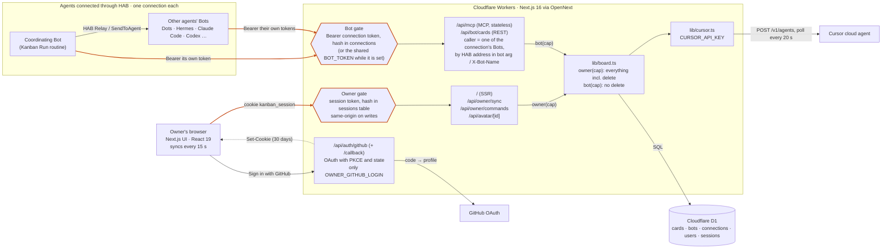
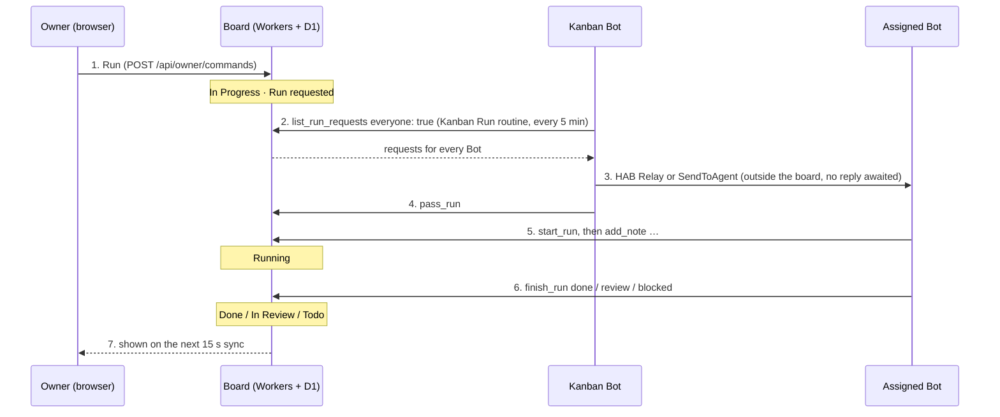

# Architecture

How the board is put together as of October 2026, with the authentication paths drawn out. GitHub renders the diagrams below.

## Components and entry points

There are two ways in. The owner signs in with GitHub and gets a session kept in the database (`lib/accounts.ts`). Each agent calls with its connection's token, issued on the board and stored only as a hash. Past the gates only two capabilities remain, `Owner` and `Bot` (`lib/auth.ts`). A `Bot` carries its scope: the connection's Bots, or, for the shared `BOT_TOKEN` kept during the move, any Bot. `lib/board.ts` checks the `bot` argument against that scope on every call. There is no middleware: every route calls `requireOwner` or `requireBot` itself, and the SSR page looks up the session directly.

## Running a card

The board cannot start an agent from outside, so it only queues run requests and the Bots come to fetch them.

Step 3 happens outside the board, so the board only knows about it through the `pass_run` record. Requests for the coordinating Bot itself go straight to steps 5 and 6. Each agent uses its own connection's token, and names the Bot it acts as with the `bot` argument when its connection has more than one.

## Authentication paths

| Path | Used by | Credential | Who is calling | Limits for multi-user |
| --- | --- | --- | --- | --- |
| `/api/auth/github`, `/api/auth/github/callback` | Owner | GitHub OAuth with PKCE and a one-time state cookie, no scopes | The GitHub account, recorded in `users` | Only `OWNER_GITHUB_LOGIN` is let in until each user has a board of their own. |
| `/`, `/api/owner/*`, `/api/avatar/*` | Owner | Cookie `kanban_session`: a random token whose SHA-256 is in `sessions`, 30 days. Writes also need a same-origin `Origin` | A user, but routes only get the `Owner` capability | Sessions end one by one on sign-out. The board itself is still one, with no owner column. |
| `/api/auth/logout` | Owner | Same-origin POST | The session's user | Deletes the session row. |
| `/api/mcp` | Every agent | `Authorization: Bearer <connection token>`, SHA-256 in `connections` | `bot` argument, checked against the connection's Bots; optional when it has one | Bots in one connection can act as each other, as in HAB's groups. Revoking a connection stops its token at once. |
| `/api/bot/cards` | Agents, scripts | Same connection token | Optional `X-Bot-Name` header, checked the same way | Same as MCP. |
| `/api/mcp`, `/api/bot/cards` | Agents not moved yet | The shared `BOT_TOKEN`, while it is set | `bot` argument, self-declared | Anyone with it can act under any name, and a new name joins the roster. Unset it once every agent has a connection. |
| Cursor API (outbound) | Server | `CURSOR_API_KEY` | One Cursor account | Every user would share one Cursor account and the repositories its key reaches. |

## What an auth redesign has to touch

- The `Owner` capability holds no identity, and a `Bot` only its connection's Bots. Adding users means putting a user id into the capabilities and passing it through every operation in `lib/board.ts`.
- The data has no owner column either: `cards`, `bots`, and `connections` make one board. Whether several people share one board or each gets their own decides how much the schema changes.
- A Bot's identity comes from its connection, so an agent can act only as its own Bots. HAB's own credentials (Auth0 and the Relay registry) are not used here yet; when they are, a HAB-issued token could replace the board's own and keep the same address check.
- The owner side has two paths: the SSR page looks up the session itself, and the API routes go through `requireOwner`. Both now use GitHub sessions; giving each user their own board means passing the user from both into `lib/board.ts`.
